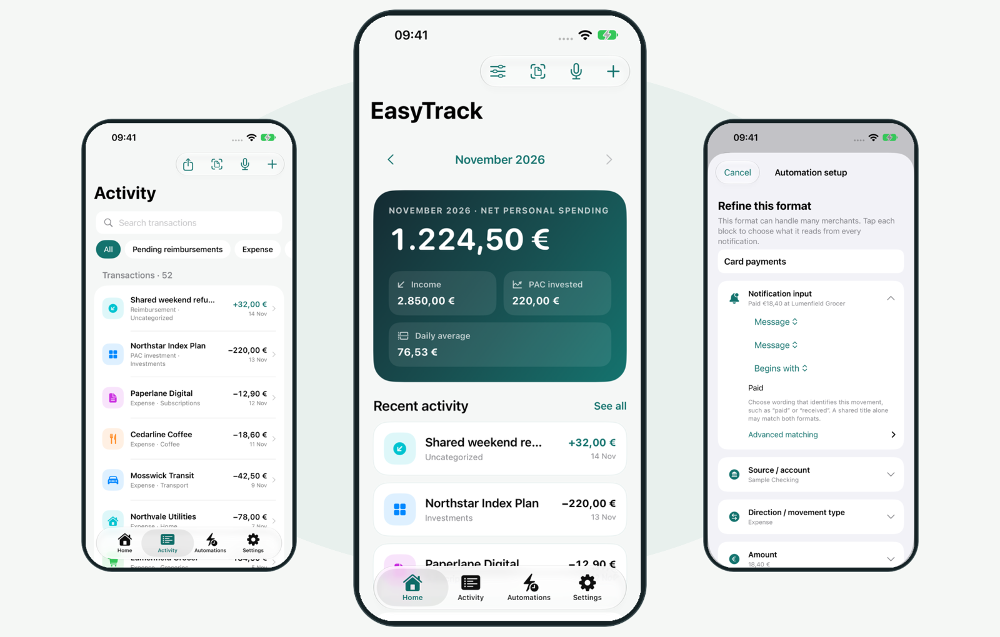
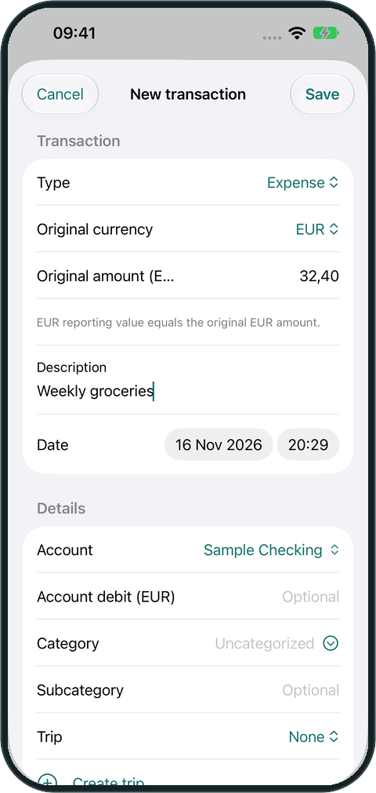
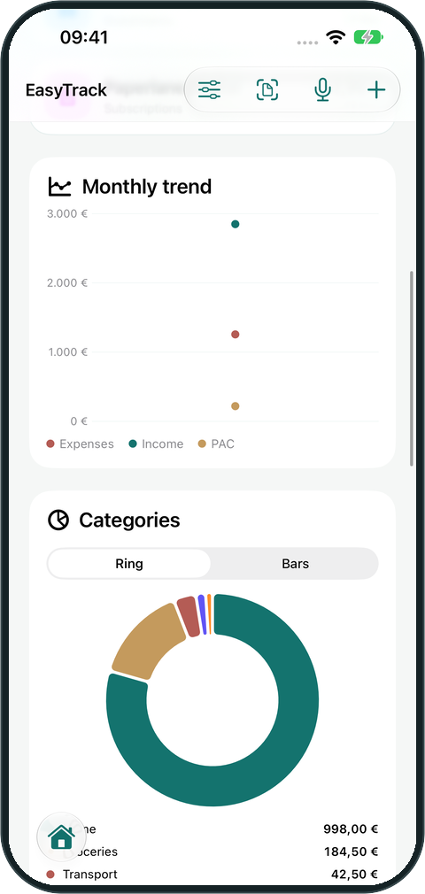
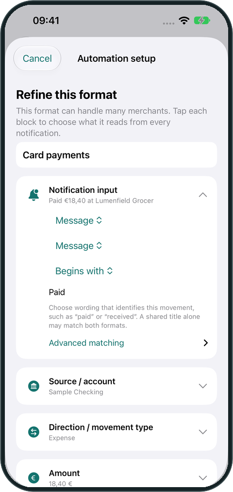

  

<h1 align="center">EasyTrack</h1>

<strong>Le tue spese, sempre chiare. Il tuo registro, sul tuo iPhone.</strong>

Un’app nativa per le finanze personali, sviluppata con SwiftUI e SQLite.

  <a href="README.md">English</a> · <strong>Italiano</strong> 
  <a href="#installazione">Installa</a> · <a href="docs/it/README.md">Documentazione</a> · <a href="docs/it/DEVELOPMENT.md">Sviluppo</a> · <a href="https://github.com/Natizh/EasyTrack/issues">Issue</a>

<kbd>iPhone · iOS 17+</kbd> <kbd>SwiftUI</kbd> <kbd>SQLite</kbd> <kbd>English / Italiano</kbd>

Schermate reali dell’app su simulatore iPhone. Tutti i dati visibili sono fittizi.

## Un registro quotidiano più chiaro

Registra un pagamento, controlla i rimborsi attesi e capisci come sta andando il mese senza perdere i dettagli. Il registro rimane sul tuo iPhone, senza richiedere un account o un servizio cloud. Sei tu a scegliere quando salvare un backup o esportare i movimenti.

| Esigenza quotidiana | Cosa offre EasyTrack |
| --- | --- |
| Inserire rapidamente una spesa | Inserimento manuale, conto predefinito, OCR degli scontrini con conferma e inserimento vocale sul dispositivo dove supportato. |
| Capire l’andamento del mese | Indicatori Home configurabili, ricerca in Attività, analisi per categoria ed esercente, budget e obiettivi. |
| Distinguere i pagamenti | Spese, entrate, investimenti PAC, anticipi, rimborsi, depositi e restituzioni di depositi. |
| Seguire le scadenze | Piani ricorrenti con date attese e abbinamento esplicito ai pagamenti effettivi. |
| Acquisire messaggi di pagamento | Un’automazione di Comandi Rapidi configurata dall’utente e formati di notifica locali. |
| Gestire i propri dati | Backup/ripristino JSON, esportazione CSV/XLSX filtrata e convertitore dello storico Excel. |

**Totali comprensibili:** le Entrate comprendono i rimborsi effettivamente ricevuti; un rimborso previsto resta in attesa. Il Netto è Entrate meno Spese lorde. I PAC attesi non incidono sui totali finché non vengono registrati o collegati a un movimento effettivo. [Esempi contabili →](docs/it/FINANCIAL_ACCOUNTING.md)

## Dentro l’app

  
  
  

Inserimento rapido · Analisi mensili · Formati di notifica

## Installazione

**SideStore è consigliato per l’uso quotidiano su iPhone.** Dopo la configurazione iniziale rinnovi la firma dal telefono senza riaprire Xcode. Scegli Xcode per compilare, modificare o analizzare EasyTrack con il debugger.

| | SideStore — uso quotidiano | Xcode — sviluppo |
| --- | --- | --- |
| Installazione o aggiornamento | Importi un IPA non firmato compatibile. | Compili ed esegui il sorgente da un Mac. |
| Rinnovo della firma gratuita | Rinnovi dall’iPhone dopo il setup iniziale. | Rifirmi e reinstalli da Xcode. |
| Requisiti iniziali | Setup con computer, account Apple, abbinamento e VPN locale. | Mac, Xcode compatibile, account Apple e configurazione della firma. |
| Aspetti da considerare | Mantieni abbinamento/VPN e controlli il rinnovo; anche SideStore occupa uno slot app. | Accesso a sorgente, simulatore e debugger; serve un Mac per installare le build. |

Entrambi i metodi con account Apple gratuito hanno una **validità della firma di sette giorni**. SideStore riduce la manutenzione ordinaria, ma non elimina i limiti Apple e non garantisce il rinnovo in background. Consulta le [FAQ SideStore](https://docs.sidestore.io/it/docs/faq) e le [informazioni Apple sugli account](https://developer.apple.com/help/account/basics/about-your-developer-account/).

> **Serve comunque un IPA.** Al momento il repository pubblica il sorgente, senza una release IPA precompilata. SideStore installa l’app, ma non la compila. Per creare il pacchetto autonomamente servono un Mac e Xcode.

1. **Usa SideStore:** segui la [guida a installazione e aggiornamenti](docs/it/SIDESTORE_INSTALL.md), che spiega anche come ottenere l’IPA.
2. **Usa Xcode:** segui la [guida al sorgente](docs/it/XCODE_INSTALL.md) per simulatore, dispositivo o build IPA non firmate.
3. **Usi già EasyTrack?** [Esporta un backup JSON](docs/it/BACKUP_RESTORE.md) prima di aggiornare. Mantieni la stessa installazione e identità di firma; non disinstallare l’app che contiene il registro.

## I primi minuti

1. **Scegli la lingua.** EasyTrack parte in italiano. Puoi cambiarla da **Impostazioni → Lingua / Settings → Language**.
2. **Aggiungi un conto** in Impostazioni → Conti e impostane uno predefinito per l’inserimento rapido.
3. **Registra un movimento**, poi controllane conto, data e categoria in Attività.
4. **Salva un backup JSON** in una posizione di File esterna all’app.

Per automatizzare l’inserimento, [collega le notifiche con Comandi Rapidi](docs/it/SHORTCUTS_SETUP.md). EasyTrack riceve solo i campi passati dall’automazione; non legge autonomamente le notifiche delle altre app. Disponibilità del trigger e consegna a schermo bloccato dipendono da iOS.

Per recuperare i dati esistenti, [importa uno storico Excel](docs/it/EXCEL_IMPORT.md): converti il foglio in un database SQLite di importazione, poi verificalo su iPhone. Sono inclusi un [foglio fittizio](docs/examples/EasyTrack-example-import.xlsx) e la [configurazione corrispondente](docs/examples/simple-import-mapping.json).

## Privacy e controllo dei dati

Il registro è nel database SQLite privato dell’app. I backup salvati con File sono istantanee volontarie, anche quando scegli iCloud Drive; **non sono una sincronizzazione continua**. I backup JSON non sono cifrati e possono contenere il testo delle notifiche acquisite: conservali privatamente.

OCR e inserimento vocale supportato vengono eseguiti sul dispositivo. La ricerca facoltativa dei cambi contatta Frankfurter su richiesta; il registro non richiede servizi di rete. SideStore usa separatamente i servizi Apple per installazione e rinnovo della firma. [Backup e ripristino →](docs/it/BACKUP_RESTORE.md)

## Documentazione

| Voglio… | Italiano | English |
| --- | --- | --- |
| Trovare una guida | [Indice documentazione](docs/it/README.md) | [Documentation index](docs/en/README.md) |
| Installare e aggiornare | [SideStore](docs/it/SIDESTORE_INSTALL.md) | [SideStore](docs/en/SIDESTORE_INSTALL.md) |
| Configurare le notifiche | [Comandi Rapidi](docs/it/SHORTCUTS_SETUP.md) | [Shortcuts](docs/en/SHORTCUTS_SETUP.md) |
| Proteggere o trasferire il registro | [Backup e ripristino](docs/it/BACKUP_RESTORE.md) | [Backup and restore](docs/en/BACKUP_RESTORE.md) |
| Compilare o contribuire | [Sviluppo](docs/it/DEVELOPMENT.md) | [Development](docs/en/DEVELOPMENT.md) |

## Stato del progetto e contributi

EasyTrack è in sviluppo attivo. Il sorgente prevede iOS 17+; per compilarlo serve Xcode 26 o successivo. Schermate e test su simulatore non dimostrano la consegna delle notifiche reali, l’esecuzione a schermo bloccato o la compatibilità con ogni provider di File. Le verifiche su dispositivo sono raccolte nella [issue #8](https://github.com/Natizh/EasyTrack/issues/8).

Consulta le [issue esistenti](https://github.com/Natizh/EasyTrack/issues) prima di proporre una modifica. Includi passaggi riproducibili, versioni dell’app e di iOS ed esempi fittizi; conserva privatamente i file finanziari reali. Comandi, mappa dei sorgenti e convenzioni sono nella [guida per contribuire](docs/it/DEVELOPMENT.md).
