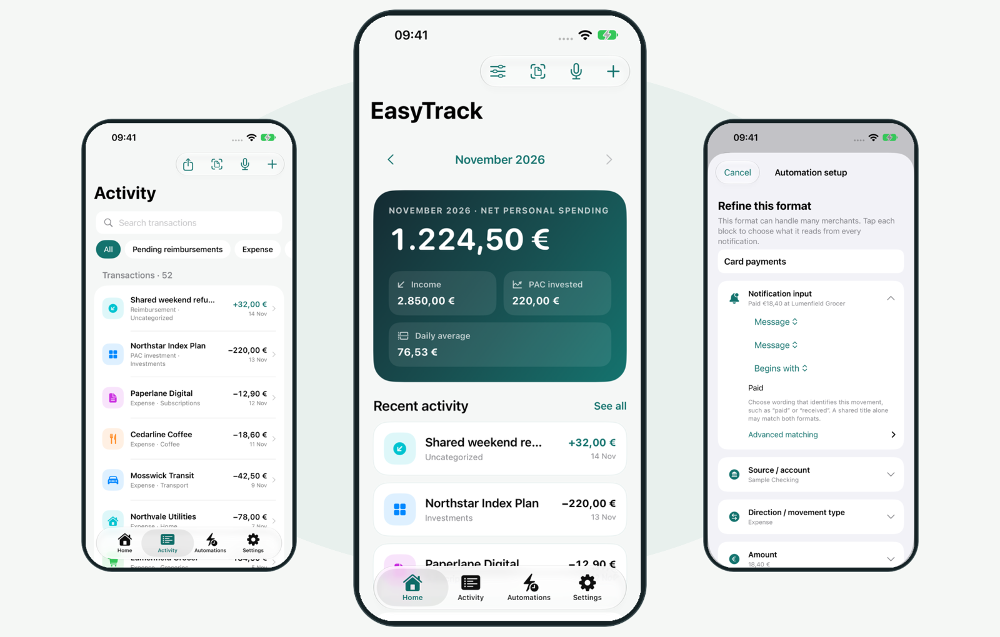
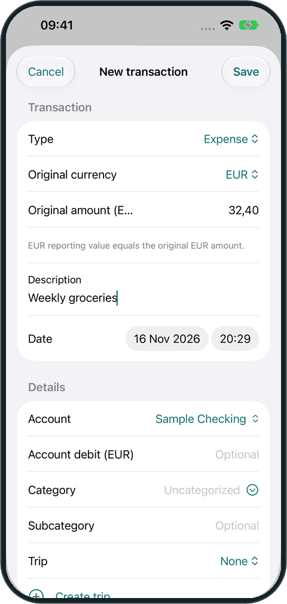
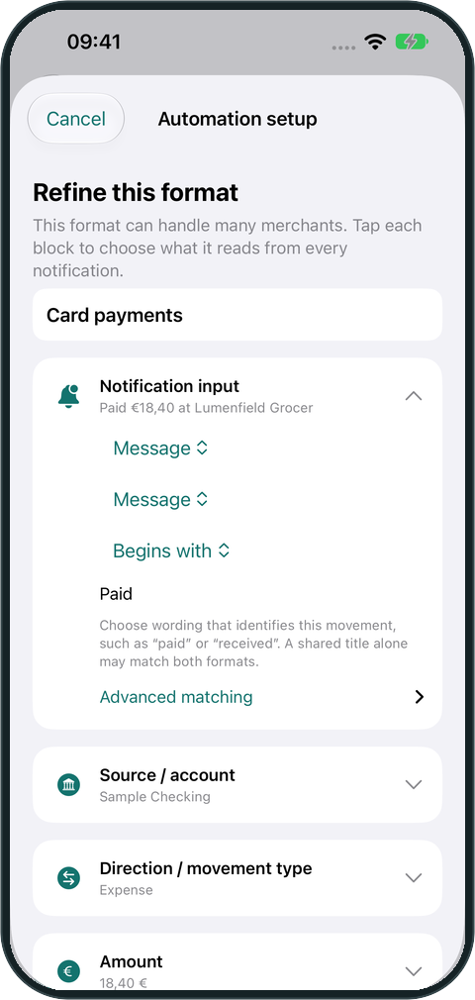

  

<h1 align="center">EasyTrack</h1>

<strong>Your spending, clearly in view. Your ledger, on your iPhone.</strong>

A native personal finance app built with SwiftUI and SQLite.

  <strong>English</strong> · <a href="README.it.md">Italiano</a> 
  <a href="#installation">Install</a> · <a href="docs/en/README.md">Documentation</a> · <a href="docs/en/DEVELOPMENT.md">Develop</a> · <a href="https://github.com/Natizh/EasyTrack/issues">Issues</a>

<kbd>iPhone · iOS 17+</kbd> <kbd>SwiftUI</kbd> <kbd>SQLite</kbd> <kbd>English / Italiano</kbd>

Real app screens from an iPhone simulator. All visible data is fictional.

## A clearer everyday ledger

Record a payment, track outstanding reimbursements, and understand your month without losing the details. Your working ledger stays on your iPhone, with no account or cloud backend required. You choose when to save a backup or export transactions.

| Everyday task | What EasyTrack offers |
| --- | --- |
| Record spending quickly | Manual entry, a default account, receipt OCR with review, and optional on-device speech entry. |
| Understand your month | Configurable Home metrics, searchable Activity, category and merchant reports, budgets and goals. |
| Keep payments distinct | Expenses, income, PAC investments, advances, reimbursements, deposits and deposit returns. |
| Track what is due | Recurring plans with expected dates and explicit matching to actual payments. |
| Capture payment messages | A user-configured Shortcuts automation and local notification formats. |
| Control your data | JSON backup/restore, filtered CSV/XLSX export, and a converter for Excel history. |

**Clear totals:** Income includes reimbursements actually received; an expected refund remains pending. Net is Income minus gross Expenses. Expected PAC investments affect no financial total until recorded or linked to an actual movement. [Accounting examples →](docs/en/FINANCIAL_ACCOUNTING.md)

## Inside the app

  
  
  

Quick entry · Monthly reports · Notification formats

## Installation

**SideStore is recommended for everyday iPhone use.** After its initial setup, renew signing on the phone without reopening Xcode. Choose Xcode to build, change or debug EasyTrack.

| | SideStore — everyday use | Xcode — development |
| --- | --- | --- |
| Install or update | Import a compatible unsigned IPA. | Build and run the source from a Mac. |
| Renew free signing | Refresh on iPhone after initial setup. | Re-sign and reinstall from Xcode. |
| Initial requirements | Computer-assisted setup, Apple account, pairing and local VPN. | Mac, compatible Xcode, Apple account and signing setup. |
| Trade-off | Maintain pairing/VPN and check refresh succeeds; SideStore uses an app slot too. | Source, simulator and debugger access; a Mac is needed for deployment. |

Both routes using a free Apple account have a **seven-day provisioning period**. SideStore reduces routine maintenance; it does not remove Apple's limits or guarantee background refresh. See the [SideStore FAQ](https://docs.sidestore.io/docs/faq.html) and [Apple account guidance](https://developer.apple.com/help/account/basics/about-your-developer-account/).

> **You still need an IPA.** This repository currently publishes source without a prebuilt IPA release. SideStore installs the app; it does not compile it. Building your own package requires a Mac and Xcode.

1. **Use SideStore:** follow the [installation and update guide](docs/en/SIDESTORE_INSTALL.md), including how to obtain an IPA.
2. **Use Xcode:** follow the [source build guide](docs/en/XCODE_INSTALL.md) for simulator, device or unsigned IPA builds.
3. **Already using EasyTrack?** [Export a JSON backup](docs/en/BACKUP_RESTORE.md) before updating. Keep the same installation and signing identity; do not uninstall the app holding your ledger.

## Your first few minutes

1. **Choose a language.** EasyTrack starts in Italian. Change it in **Impostazioni → Lingua / Settings → Language**.
2. **Add an account** in Settings → Accounts and choose a default for quick entry.
3. **Record a transaction**, then check its account, date and category in Activity.
4. **Save a JSON backup** to a Files location outside the app.

To automate entry, [connect payment notifications with Shortcuts](docs/en/SHORTCUTS_SETUP.md). EasyTrack receives only the fields your automation passes; it cannot independently read other apps' notifications. Trigger availability and locked-device delivery depend on iOS.

To bring existing data, [import an Excel history](docs/en/EXCEL_IMPORT.md): convert the workbook to a SQLite seed, then review it on iPhone. A [fictional workbook](docs/examples/EasyTrack-example-import.xlsx) and [matching configuration](docs/examples/simple-import-mapping.json) are included.

## Privacy and data ownership

The ledger lives in the app's private SQLite database. Files backups are deliberate snapshots, including when saved to iCloud Drive; they are **not live synchronization**. JSON backups are unencrypted and may include captured notification text. Keep them private.

Receipt OCR and supported speech entry run on device. An optional currency-rate lookup contacts Frankfurter when requested; the core ledger needs no network service. SideStore uses separate Apple signing services for installation and renewal. [Backup and restore →](docs/en/BACKUP_RESTORE.md)

## Documentation

| I want to… | English | Italiano |
| --- | --- | --- |
| Find a guide | [Documentation index](docs/en/README.md) | [Indice documentazione](docs/it/README.md) |
| Install and update | [SideStore](docs/en/SIDESTORE_INSTALL.md) | [SideStore](docs/it/SIDESTORE_INSTALL.md) |
| Configure notifications | [Shortcuts](docs/en/SHORTCUTS_SETUP.md) | [Comandi Rapidi](docs/it/SHORTCUTS_SETUP.md) |
| Protect or move my ledger | [Backup and restore](docs/en/BACKUP_RESTORE.md) | [Backup e ripristino](docs/it/BACKUP_RESTORE.md) |
| Build or contribute | [Development](docs/en/DEVELOPMENT.md) | [Sviluppo](docs/it/DEVELOPMENT.md) |

## Project status and contributions

EasyTrack is under active development. The source targets iOS 17+; building requires Xcode 26 or later. Simulator screenshots and automated tests do not establish real notification delivery, locked-device execution or compatibility with every Files provider. Device acceptance work is tracked in [issue #8](https://github.com/Natizh/EasyTrack/issues/8).

Check [existing issues](https://github.com/Natizh/EasyTrack/issues) before proposing a change. Include reproducible steps, app/iOS versions and fictional examples; keep real financial files private. Commands, the source map and documentation conventions are in the [contributor guide](docs/en/DEVELOPMENT.md).
