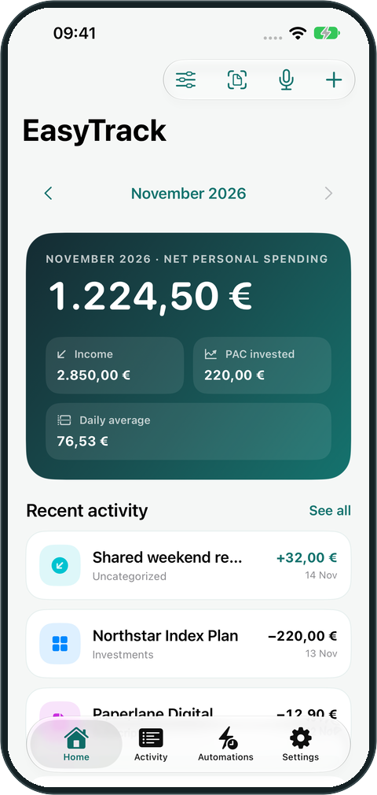
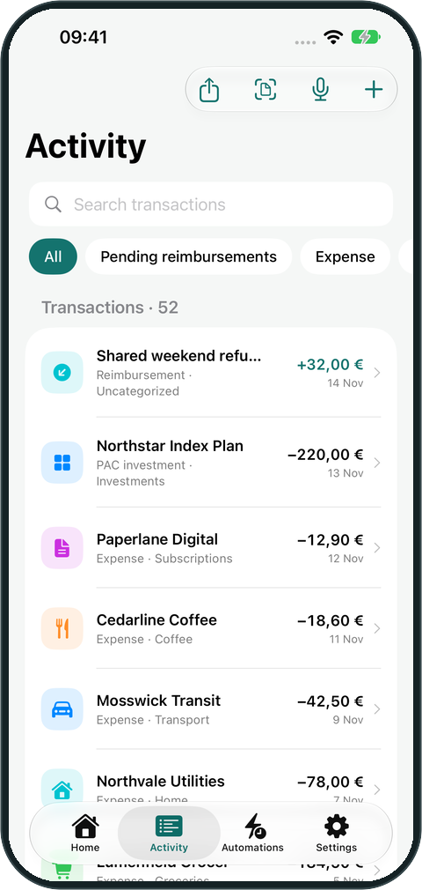
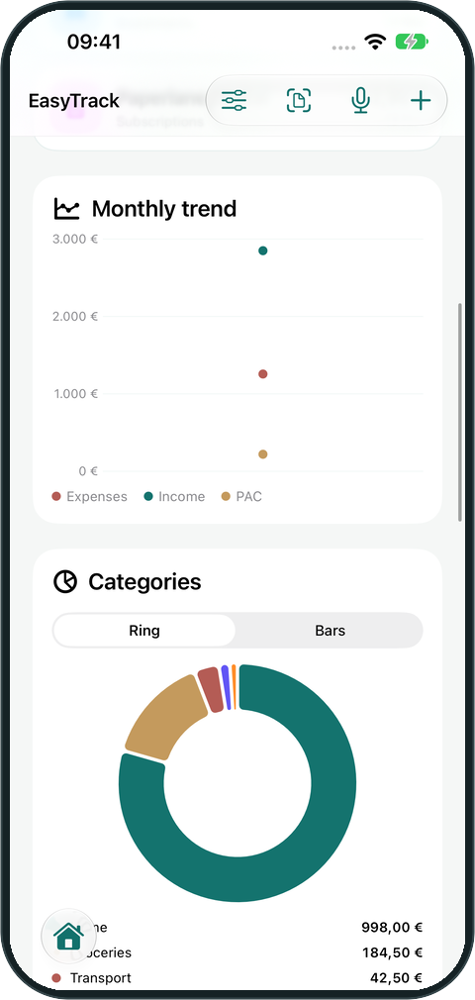
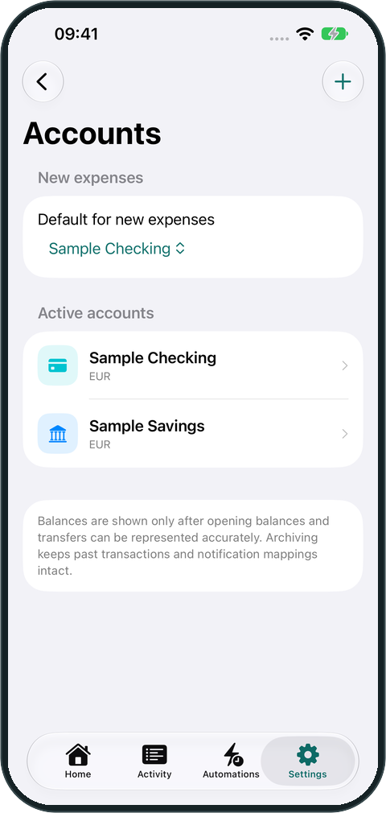

# EasyTrack

**Private, native expense tracking for iPhone.**

EasyTrack helps you record daily spending, see where your money goes, and keep a clear local history. The ledger lives in SQLite on your iPhone; backups and exports are yours to make and store.

<kbd>SwiftUI</kbd> <kbd>iOS 17+</kbd> <kbd>SQLite</kbd> <kbd>Local-first</kbd>

> **New to Apple Shortcuts? / Mai usato Comandi Rapidi?** Follow the [complete notification setup tutorial](docs/SHORTCUTS_SETUP.md) to connect a payment app to EasyTrack with fictional examples. The essential steps are also below.


<sub>Captured from a running EasyTrack build on an iPhone simulator. Every visible transaction and notification is fictional.</sub>

## Why EasyTrack?

- **Quick to use.** Add a transaction from Home, choose a default account, and keep everyday details within reach.
- **Native by design.** SwiftUI screens, accessible controls, adaptable text, and familiar iPhone navigation.
- **Your ledger stays local.** The main app needs no account or cloud backend. JSON backups are deliberate Files exports, not silent synchronization.
- **Useful detail without clutter.** Choose the main Home metric and the smaller values beneath it; see trends, categories, budgets, and upcoming payments when you need them.

## Inside the app

<p align="center">
  
  
  
</p>

<p align="center">
  
  
  
</p>

- **Transactions and accounts:** expenses, income, PAC, reimbursements, categories, account defaults, and searchable Activity history.
- **Dashboard and reports:** configurable Home KPIs, monthly trend, category and merchant views, budgets, and goals.
- **Clear cash flow:** Home Net is Income minus gross Expenses. Received reimbursements count as Income; expected but unpaid refunds stay in Net Expenses and Pending Reimbursements. Tap Income or Expenses to see the complete Activity list for the selected month. See the [accounting policy](docs/FINANCIAL_ACCOUNTING.md).
- **Recurring payments:** scheduled expenses, income, and PAC plans with explicit review when an imported or notified payment might overlap.
- **Notification capture:** a user-configured **Apple Shortcuts automation** passes notification fields to an App Intent. Local rules extract and check them; ambiguous matches create no transaction. EasyTrack cannot independently read every bank notification.
- **Ways to enter data:** manual entry, on-device receipt OCR with review, and optional on-device speech entry where supported.
- **Control of your data:** manual JSON backup/restore, filtered CSV/XLSX export, and a mapped historical-import path described below.

## Getting started

### Set up payment notifications with Shortcuts

EasyTrack cannot read every notification by itself. You create a **personal automation** in Apple's **Comandi Rapidi / Shortcuts** that passes one selected app's notification to EasyTrack. The available trigger fields and automatic execution can vary by iOS version and app; a captured notification is not yet a transaction.

1. In **EasyTrack → Automations → Notification setup**, choose the EasyTrack account that should receive this source's movements. Enter a stable **Source app label**, for example `Northstar Pay (fictional)`, tap **Save source and account**, then **Copy name**. Create an account first in Settings → Accounts if needed. Do not enter credentials or card numbers.
2. Open **Comandi Rapidi → Automazione → + / New Automation → Notifica → App**. Choose the **bank or payment app that sends the notification** in this trigger. Start without narrow Title/Subtitle/Message filters. If iOS offers automatic execution, enable it and accept the required Shortcuts permissions. The app chosen here and the EasyTrack source label are separate choices.
3. Choose **Add Action → EasyTrack → Capture Payment Notification** (the action summary may say **Capture notification from [source]**). Paste the **exact saved label** into **Source app**. This is fixed text, not a magic variable or an app picker.
4. For each of the next fields, tap its **value**, insert the blue **🔔 Notifica** variable from the trigger, tap that blue chip to open **Ottieni**, and select the property shown below. Repeat independently for every field; do not type a sample amount or pass the whole Notifica object.

   | EasyTrack action field | Dynamic notification property |
   | --- | --- |
   | **Title** | `Notifica → Titolo` |
   | **Subtitle** | `Notifica → Sottotitolo` (may be empty) |
   | **Message** | `Notifica → Corpo` |
   | **Notification date** | `Notifica → Data` **only if Shortcuts supplies a Date-typed value**; otherwise leave it empty and EasyTrack uses capture time |

5. Save the automation. A manual Shortcuts run with **fictional fixed values** checks only that the EasyTrack action can receive input. To check the trigger and dynamic bindings, generate a harmless notification you control, then inspect **EasyTrack → Automations → [source] → Captured notifications**. Two harmless notifications with different text help reveal an accidentally fixed field. A captured sample alone does not add an Activity transaction.
6. Open the captured sample and choose **Set up format** or **Add notification format**. In the seven setup blocks, verify the account, payment direction, EUR amount, merchant, duplicate protection and proposed transaction; test the draft and explicitly activate the format. Incoming and outgoing notifications may need separate formats. Choose whether the first sample itself should create a transaction. Check Activity and avoid adding a duplicate manually.
7. If nothing arrives, check the selected trigger app, Shortcuts permissions, automatic execution, exact source label and blue variable properties. If a sample arrives without an amount, check `Message → Corpo` before changing parser anchors. See the [full troubleshooting guide](docs/SHORTCUTS_SETUP.md#troubleshooting--risoluzione-dei-problemi) for missing actions, empty fields, duplicate status, SideStore refresh and locked/background behavior.

Never post real bank notifications, screenshots or amounts in public issues. Real-device Shortcuts delivery is not guaranteed by simulator or parser tests.

### Build with Xcode

The project targets **iPhone running iOS 17 or later**. Use Xcode 26 or later for the iOS 26 SwiftUI tab API used by the project. Apple lists macOS Sequoia 15.6–Tahoe 26.x for Xcode 26, and macOS Tahoe 26.6 or later for Xcode 27.2; check [Apple's compatibility table](https://developer.apple.com/xcode/system-requirements) for your chosen release.

1. Clone the repository with an account that has access: `git clone https://github.com/Natizh/EasyTrack.git`.
2. Open `EasyTrack.xcodeproj` in Xcode.
3. For a simulator, select an installed iPhone simulator and choose **Run**. For a physical iPhone, select your device, choose your team under **Signing & Capabilities**, enable Developer Mode if prompted, then choose **Run**. A unique local bundle ID may be needed for your signing team.

A free Apple Personal Team can install a development build on a personal device, but its provisioning profile expires after **seven days**. Rebuild and reinstall or re-sign the app when it expires; a free-signing install is not permanent ([Apple account guidance](https://developer.apple.com/help/account/basics/about-your-developer-account/)). Back up your ledger before replacing or deleting an installation.

### Optional SideStore path

The repository includes [`scripts/package_unsigned_ipa.sh`](scripts/package_unsigned_ipa.sh) for packaging a locally built Release app as an **unsigned** IPA. Build for a generic iOS device with `-derivedDataPath DerivedData`, then run the helper:

```sh
xcodebuild -project EasyTrack.xcodeproj -scheme EasyTrack -configuration Release \
  -destination 'generic/platform=iOS' -derivedDataPath DerivedData \
  PRODUCT_BUNDLE_IDENTIFIER=local.easytrack.finance CODE_SIGNING_ALLOWED=NO build
sh scripts/package_unsigned_ipa.sh
```

The package helper refuses to overwrite an existing IPA. Set `EASYTRACK_IPA_OUTPUT` to a new path to keep older builds, and `EASYTRACK_DERIVED_DATA` if reusing a build cache outside this checkout. Check the resulting IPA's original bundle ID and build number before importing it; an iPhone update still needs a fresh external JSON backup and real-device verification.

There is no prebuilt EasyTrack IPA or App Store release here. [SideStore](https://docs.sidestore.io/docs/installation/install) can sign and install a compatible IPA using your Apple account after its pairing and local VPN setup. Import the local IPA into SideStore and refresh it before its seven-day development signing period expires ([SideStore FAQ](https://docs.sidestore.io/docs/faq.html)). EasyTrack itself does not depend on SideStore at runtime. Physical-device installation and refresh for this project still need the validation tracked in [issue #8](https://github.com/Natizh/EasyTrack/issues/8).

## Bring an Excel history

EasyTrack currently imports a **SQLite seed**, not an XLSX file directly. The supported route is:

```text
XLSX workbook → Python converter → SQLite seed → EasyTrack import preview
```

Start with the [fictional, working Excel example](docs/examples/EasyTrack-example-import.xlsx) and its [simple column mapping](docs/examples/simple-import-mapping.json). It has one `Movements` sheet with an expense, income, and PAC investment. Enter amounts in **normal currency units** (`24.90` means €24.90), keep each `Source ID` stable, then run the converter. EasyTrack shows a preview before any local ledger change.

**[Follow the step-by-step Excel import guide →](docs/EXCEL_IMPORT.md)**

## Privacy and storage

EasyTrack stores the working ledger in its private local SQLite database. A Files export is a snapshot that you choose to save, including to iCloud Drive if you want; it is **not** live multi-device sync. Notification text is captured only through a Shortcuts automation you configure. Receipt text is processed on device and shown for confirmation. An optional, user-requested indicative currency-rate lookup contacts Frankfurter; the core ledger does not need it or any account service.

Keep exported backups and import seeds private. Removing an app without a separate backup can remove its local history. See [backup and restore](docs/BACKUP_RESTORE.md) for the format and restore checks.

## Under the hood

EasyTrack uses SwiftUI, Charts, App Intents, Vision, Speech, and SQLite through Apple system frameworks. The app project has no third-party runtime packages. Financial amounts are stored in integer minor units; imported source values and parser rule history remain auditable. The source is organized under `EasyTrack/App`, `UI`, `Shared`, `Persistence`, `Intake`, `Import`, and `Export`.

For a development checkout:

```sh
swift test --jobs 2
python3 -m unittest Tools/HistoricalImportConverter/test_converter.py
```

Run `python3 scripts/test_accounting_ui.py --device <existing-iPhone-17-Pro-UUID>` for a focused Home Income/Expenses navigation test with a fictional ledger and a separate simulator app container. It never installs over a pre-existing test app.

Build or run the Xcode scheme on an **existing simulator UUID**; disable parallel testing for Xcode UI tests to avoid simulator clones. The [showcase workflow](docs/SHOWCASE_ASSETS.md) explains how the synthetic screenshots on this page are regenerated without touching an existing EasyTrack installation.

To repeat the two notification and reimbursement UI journeys in PR #35, run `python3 scripts/test_pr35_ui.py --device <existing-iPhone-17-Pro-UUID>`. The runner creates a separate app identifier, installs a fictional ledger, disables parallel Xcode testing, and removes only its own test app afterward. It refuses to use a pre-existing test app container.

Further reading: [notification parsing](docs/NOTIFICATION_PARSER_DESIGN.md) · [recurring reconciliation](docs/RECURRING_RECONCILIATION.md) · [transaction export](docs/TRANSACTION_EXPORT.md) · [legacy import mapping](docs/IMPORT_MAPPING.md).

## Roadmap and contributions

Work under discussion includes [physical iPhone and SideStore validation](https://github.com/Natizh/EasyTrack/issues/8), [clearer Shortcuts field mapping](https://github.com/Natizh/EasyTrack/issues/31), and [broader currency editing](https://github.com/Natizh/EasyTrack/issues/14). These are open issues, not release promises. Browse the [issue tracker](https://github.com/Natizh/EasyTrack/issues) before proposing a change. Repository access and contributions are managed by its maintainers.
